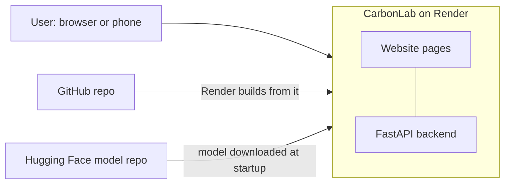

# CarbonLab: Interpretable ML for CO₂ Adsorption on Biomass-Derived Porous Carbons

Predicting CO₂ uptake (mmol/g) of biomass waste-derived porous carbons from
textural properties, elemental composition, temperature and pressure, using a
performance-weighted (entropy-TOPSIS) ensemble of tree/boosting models, with
SHAP explanations for every prediction.

- **Data:** Yuan et al. (2021), 527 data points collected from peer-reviewed publications (526 after removing one exact duplicate)
- **Method reference:** Fan et al. (2026), interpretable ensemble ML for CO₂ adsorption (MgO sorbents)
- **Scope:** this model is trained on porous-carbon data and is **not** an MgO model.

## Live demo and links

| What | Link |
|---|---|
| Live web app | https://carbonlab.onrender.com/ |
| Model on Hugging Face | https://huggingface.co/adhithyasharma/carbonlab-co2-ensemble |
| Source code | https://github.com/madhithyasharma-del/co2-adsorption-ml (branch `adhithya-version`) |

The app runs on Render's free plan, so it sleeps after 15 minutes without visitors
and the first request afterwards takes about a minute to wake it. Accounts and
prediction history are reset whenever the app is redeployed.

## Results (test set, 106 rows, evaluated once)

| Model | RMSE (mmol/g) | MAE (mmol/g) | R² |
|---|---|---|---|
| Entropy-TOPSIS ensemble (6 models) | 0.644 | 0.477 | 0.848 |

The single CatBoost model scored slightly higher than the weighted ensemble
on the test set (R² 0.866). We report this as it is: the ensemble was chosen on
validation data before the test set was opened, following the method of
Fan et al. Full tables are in `results/07_test_results.csv`.

## Enhancement over the base paper: prediction intervals

The base paper (Fan et al., 2026) reports a single predicted value. CarbonLab adds a
**90% prediction interval** to every prediction, so users see how uncertain the
estimate is (for example "4.12 mmol/g, 90% interval 3.03 – 5.21").

How it works (split-conformal prediction, `scripts/conformal_calibration.py`):

1. Run 5-fold cross-validation on the 420 development rows (train + validation). Each row gets
   an ensemble prediction from models that never saw it.
2. Take the absolute errors of those predictions. Their (finite-sample corrected) 90th percentile
   is the interval half-width: prediction ± 1.092 mmol/g.
3. Check on the 106 untouched test rows how often the true value really falls inside.

| Target level | Half-width (mmol/g) | Actual test coverage | "± z × RMSE" rule coverage |
|---|---|---|---|
| 80% | 0.724 | 78.3% | 81.1% |
| 90% | 1.092 | 92.5% | 90.6% |
| 95% | 1.437 | 96.2% | 95.3% |

The conformal widths use only development data. The "± z × RMSE" column is a simple
comparison that uses the test set's own RMSE, so it is optimistic. Limitation: the
half-width is the same for every input; it does not adapt to how uncertain a
particular prediction is. Results: `results/10_conformal_results.csv`; widths used by the
app: `artifacts/conformal.json`.

## Folder layout

```
data/raw/        original CSV, never edited
notebooks/       numbered notebooks, run in order
artifacts/       cleaned data, split assignments, configs, saved models
results/         metric tables and figures
backend/         FastAPI web API (prediction, SHAP, intervals, history, admin)
frontend/        web pages (plain HTML/CSS/JavaScript)
scripts/         conformal_calibration.py (intervals), upload_to_hf.py (publish the model)
render.yaml      deployment settings for Render
```

## Setup

```
pip install -r requirements.txt
```

Run the notebooks in order (`jupyter notebook`) to recreate `artifacts/`
and `results/` (then run `python scripts/conformal_calibration.py` for the intervals).
The web app needs `artifacts/model_bundle.joblib` (made by notebook 09; about 49 MB,
so it is not stored in git). If the file is missing, the server downloads it from
Hugging Face at startup when the setting `HF_MODEL_REPO` is set (see Deployment).

## Running the web app

Create `backend/.env` with the admin account (the server creates it at startup;
there is no "sign up as admin" on the website):

```
ADMIN_USERNAME=<admin name>
ADMIN_PASSWORD=<at least 8 characters>
```

Team accounts (optional): copy `backend/users.example.txt` to `backend/users.txt`
and list one `username password [admin]` per line. The server creates or updates
these accounts at every start, so the same logins work on any computer you move
the project to. `users.txt` is ignored by git.

To stop strangers creating accounts, add `ALLOW_SIGNUP=false` to `backend/.env`
(the "Create account" buttons then disappear).

Then, in the project folder:

```
uvicorn backend.app.main:app --host 0.0.0.0 --port 8000
```

- http://127.0.0.1:8000/ — the website (the backend serves the pages too)
- http://127.0.0.1:8000/docs — interactive API docs

To share it with anyone while your laptop runs it, start a free Cloudflare quick tunnel
in a second terminal: `cloudflared tunnel --url http://localhost:8000` and share the
`https://….trycloudflare.com` link it prints.

In `frontend/js/config.js`, `USE_MOCK = true` runs the pages on built-in demo data without the backend.

## Deployment



- **Model hosting:** the trained model (`model_bundle.joblib`, 49 MB) is published to a public
  Hugging Face model repo with `python scripts/upload_to_hf.py` (needs a write token in the
  `HF_TOKEN` environment variable). The model card there lists metrics and the interval results.
- **Web hosting:** Render builds the app from this repo using `render.yaml` and runs
  `uvicorn backend.app.main:app`. Environment variables:

| Variable | Purpose |
|---|---|
| `HF_MODEL_REPO` | Hugging Face repo to download the model from (`adhithyasharma/carbonlab-co2-ensemble`) |
| `ADMIN_USERNAME`, `ADMIN_PASSWORD` | main admin account, created at startup |
| `ALLOW_SIGNUP` | `false` hides the self sign-up buttons |

- **Free-plan limits:** 512 MB RAM and a sleeping server (see Live demo). `GET /api/health`
  reports the server's current and peak memory use.

## What the app does

**Accounts**
- Anyone can open the landing and About pages. Predicting needs an account: self sign-up (can be switched off) or one listed in `backend/users.txt`.
- Passwords are stored as salted PBKDF2-SHA256 hashes; logins are random session tokens that expire after 7 days.
- Admins log in on a separate admin login page with the account from `backend/.env`.

**For users**
- **Predict:** enter the 10 inputs (the two pore volumes may be left blank and are filled with the training median) and get the predicted CO₂ uptake with its 90% prediction interval.
- **Explain:** a SHAP waterfall chart: from the model's average, each input pushes the estimate up or down until it reaches the prediction (base value + contributions = prediction).
- **Batch:** upload a CSV (up to 5 MB / 5000 rows) and get a prediction for every row; unusable rows are listed with the reason.
- **History:** your own recent predictions, stored in a local SQLite database.
- **About:** global feature importance (mean |SHAP|) of the active model.

**For the admin** (every request needs an admin login)
- **Upload a dataset:** checks columns, row count (at least 100), non-numeric cells, blanks and duplicates before saving it.
- **Train a candidate:** runs the notebook pipeline in the background — drop duplicates, 64/16/20 split (seed 42), refit the 6 models with the tuned parameters from `artifacts/best_params.json` (no re-tuning), entropy-TOPSIS weights from validation scores, test metrics, SHAP importance.
- **Model versions:** compare a candidate with the active model, activate it, or roll back to a previous version. The original notebook model is `v1-ensemble`.
- **Users and admins:** see every account and make teammates admins (or remove it). You can't change your own role, the main admin from `backend/.env` always stays admin, and there is always at least one admin.

Accounts, uploaded datasets, trained models, the version list and the
prediction history live in `backend/data/`, which is not stored in git.

## API overview

| Method | Path | Purpose |
|---|---|---|
| GET | `/api/health` | server check, with current and peak memory use |
| GET | `/api/features` | input names with min / max / median |
| GET | `/api/models/active` | active model version and test metrics |
| GET | `/api/models/active/importance` | global SHAP importance |
| POST | `/api/predict` | one prediction + 90% interval + SHAP explanation (login) |
| POST | `/api/predict/batch` | predictions for a CSV file (login) |
| GET | `/api/predictions/history` | your last 50 predictions (login) |
| POST | `/api/auth/signup` | create a user account (logs in too) |
| POST | `/api/auth/login` | log in (user or admin) |
| GET | `/api/auth/me` | who is logged in |
| POST | `/api/auth/logout` | end the session |
| POST | `/api/admin/datasets` | upload and validate a training CSV |
| POST | `/api/admin/train` | start training a candidate |
| GET | `/api/admin/training/{job_id}` | training progress and logs |
| GET | `/api/admin/models` | all model versions |
| POST | `/api/admin/models/{version}/activate` | make a candidate active |
| POST | `/api/admin/models/{version}/rollback` | go back to a previous model |
| GET | `/api/admin/users` | all accounts with role and prediction count |
| POST | `/api/admin/users/{id}/role` | make a user an admin, or remove admin |

## Roadmap

- [x] 01 Load and audit: schema, missing values, duplicates, physical sanity checks
- [x] 02 Clean and split: drop exact duplicate, assign `row_id`, save cleaned data + train/val/test split
- [x] 03 EDA (train rows only) and baselines (Dummy, Ridge)
- [x] 04 Compare six models (RF, Extra Trees, GBR, XGBoost, LightGBM, CatBoost) with 5-fold CV
- [x] 05 Optuna tuning (objective: mean CV RMSE)
- [x] 06 Entropy-TOPSIS ensemble vs simple average vs best single model
- [x] 07 Final evaluation on the untouched test set (once)
- [x] 08 SHAP explanations
- [x] 09 Export model bundle
- [x] Web app: FastAPI backend + HTML/JS frontend (accounts, prediction, SHAP waterfall, batch, history, admin retraining and model versions)
- [x] Enhancement: conformal 90% prediction intervals, checked on the test set
- [x] Model published on Hugging Face; app deployed on Render
- [ ] Installable phone app (PWA)

## Rules this project follows

1. The raw CSV is never modified.
2. The test set is not looked at (not even in EDA) until notebook 07.
3. Every preprocessing step is fitted on training data only, inside a Pipeline.
